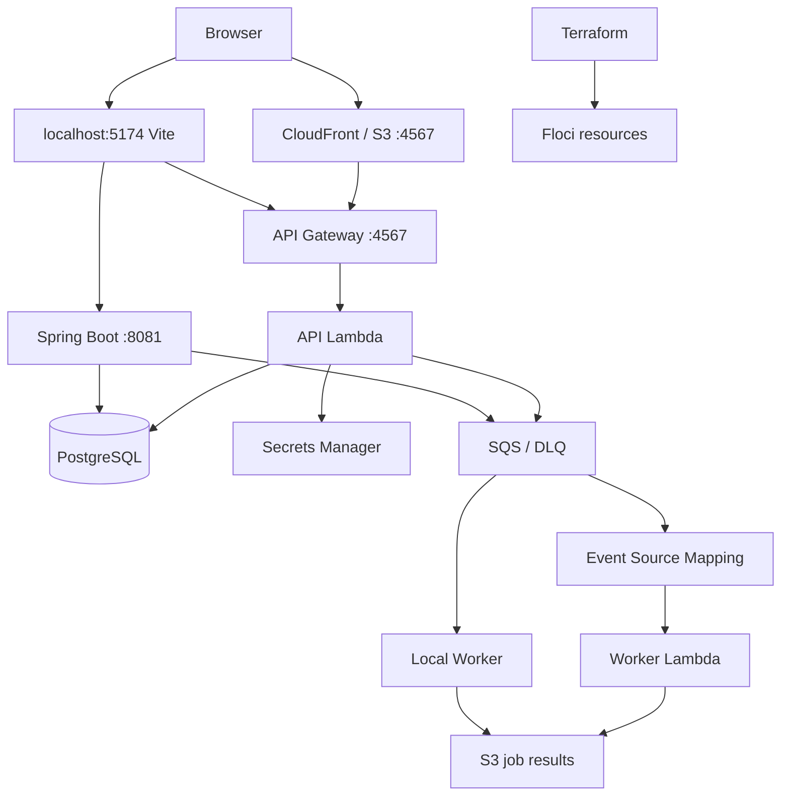

# コンテナ構成

標準開発環境はリポジトリ直下の docker-compose.yml。Compose Project は music-app-terraform-test、ネットワークは music-app-terraform-test-network。従来の Terraform 検証環境を昇格させた構成で、旧 Shell 環境とは別のデータを使用する。

| サービス | 技術 | ホスト公開 | 役割 |
|---|---|---|---|
| postgres | PostgreSQL 16 | なし（内部 5432） | tests、test_jobs |
| floci | latest-compat | 127.0.0.1:4567 | S3、SQS、DLQ、Cognito、SSM、Secrets Manager、Lambda、API Gateway、CloudFront |
| frontend | Node.js 24 / Vite | 127.0.0.1:5174 | React 開発サーバー |
| backend | Java 25 / Gradle | 127.0.0.1:8081 | Spring Boot 直接開発 |
| terraform | Terraform 1.15.8 | なし | tools Profile の一時実行 |
| worker-local | Java 25 | なし | worker-local Profile の SQS ポーリング |

Mapping と Local Worker は排他的。Terraform がリソース定義を管理し、Shell はビルド・ZIP配備・Secret実値・テストユーザー・Runtime Config・Frontend配備を担当する。

| 保持対象 | 配置 |
|---|---|
| PostgreSQL Volume | music-app-terraform-test_terraform_test_postgres_data |
| Floci Volume | music-app-terraform-test_terraform_test_floci_data |
| Node modules Volume | music-app-terraform-test_terraform_test_frontend_node_modules |
| Terraform State・tfvars | .docker-cache/terraform-test/terraform/local/ |
| Runtime Config | .docker-cache/terraform-test/frontend-config/local-config.json |

旧構成の画像は移行前の記録として残す。現在の接続・構成は上記の表と図を正とする。

- [環境構築手順](../開発環境/環境構築手順書.md)
- [動作確認手順](../開発環境/動作確認手順書.md)
